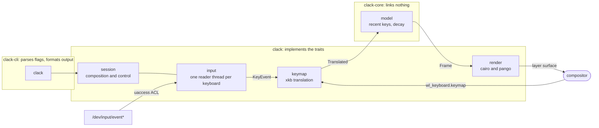

# Decisions

Why Clack is built this way, and what was tried and rejected. See [`README.md`](README.md) for what
it does and [`engineering/README.md`](engineering/README.md) for how it is written.

## Reading the keys

X11 is a global input broker: any client can ask for every key event, which is how
[screenkey](https://www.thregr.org/wavexx/software/screenkey/) works. Wayland has no broker. Key
events reach only the [focused surface](https://wayland-book.com/seat/keyboard.html), and no
protocol exposes the rest. Wayland also has no client-side window positioning, so screenkey's
absolute placement fails too. Under XWayland it still sees X11 clients, which is why it looks half
broken rather than dead.

Four ways to get the keys. One works.

| Source | Verdict |
|---|---|
| [`wl_keyboard`](https://wayland.app/protocols/wayland#wl_keyboard) key events | No. The compositor must not send `key` unless the client's surface holds focus. |
| [InputCapture portal](https://flatpak.github.io/xdg-desktop-portal/docs/doc-org.freedesktop.portal.InputCapture.html) | No. Built for InputLeap-style edge handoff: events arrive only after a declared barrier is crossed. |
| [RemoteDesktop portal with libei](http://who-t.blogspot.com/2022/12/libei-opening-portal-doors.html) | No. Emulation-first, same capture semantics. The EIS implementation decides which devices exist and when they may send. |
| evdev on `/dev/input/event*` | Yes. Below the compositor. Works on KWin, Mutter, wlroots, and a bare TTY. Needs privileges. |

Not libinput, which wshowkeys and Show Me The Key both use. Clack wants raw key codes, so
libinput's value (pointer acceleration, gestures, device grouping) would be discarded, and it forces
the `open_restricted` privilege callback. The [`evdev`](https://docs.rs/evdev) crate reads the same
devices with no C dependency. The cost is hotplug, recoverable with an inotify watch on
`/dev/input`.

### Privileges

A udev [`uaccess`](https://www.freedesktop.org/software/systemd/man/latest/udev.html) rule is the
default: logind grants an ACL to the active seat's user, revoked at logout. Rejected: `input` group
membership, which is permanent and seat-independent, and setuid, which is hard to audit. A pkexec
helper passing read-only fds over `SCM_RIGHTS` is the fallback for users who will not install a
rule.

- The rule must sort after `60-input-id.rules`, which sets `ID_INPUT_KEYBOARD`, and before
  `73-seat-late.rules`, which applies the ACL. Hence `65-`.
- Installing the package alone does nothing: udev only reads rules a system has been told about. The
  NixOS module uses `services.udev.packages`; elsewhere `clack --grant-access` writes the rule
  through polkit.
- `--revoke-access` deletes the rule and strips the ACL from existing device nodes, which logind has
  already applied and nothing removes until the node is recreated or the user logs out. Only
  keyboards are touched, and the `udevadm trigger` that follows restores what other rules tag.

## Turning codes into symbols

evdev gives raw key codes. An [XKB](https://xkbcommon.org/doc/current/) keymap turns them into
`Shift+A` or `é`. XKB keycodes sit eight places above kernel codes.

`wl_keyboard.keymap` is sent to any client that calls `wl_seat.get_keyboard`, with no surface and no
focus required; only `key` needs focus. Clack pulls the compositor's live keymap that way, so the
layouts configured in the desktop's own settings are what it displays. Show Me The Key compiles its
own XKB config and misses desktop-level remaps. Verified on KWin: 36826 bytes, seat `seat0`, no
surface, no focus.

Open question: the active layout group index arrives in `wl_keyboard.modifiers`, which a compositor
may send without focus but need not.

## Drawing

[`wlr-layer-shell`](https://wayland.app/protocols/wlr-layer-shell-unstable-v1), overlay layer,
implemented by KWin at version 6.6 and by Mutter, sway, Hyprland, COSMIC, and Weston. It gives edge
anchoring and guaranteed z-order, and with an empty input region and `keyboard_interactivity = none`
a surface that never takes focus or clicks. A plain toplevel cannot do this, because a Wayland
client cannot raise or pin itself: Show Me The Key uses a GTK toplevel plus user-written window
rules, and on Plasma it ends up underneath other windows.

Two KWin behaviours found the hard way:

- A layer surface becomes mappable only after an empty commit answered by a configure. Waiting for a
  configure on every resize hangs, because a mapped surface at an unchanged size gives the
  compositor nothing to say.
- Never unmap. An unmapped layer surface returns without its anchor and assigned to the current
  workspace only. Clack stays mapped and paints a transparent buffer when idle.

Scale is tracked in 120ths throughout, so the fractional and whole-number paths are one code path.
[`wp_fractional_scale_v1`](https://wayland.app/protocols/fractional-scale-v1) reports the scale in
120ths and [`wp_viewporter`](https://wayland.app/protocols/viewporter) maps a buffer drawn at that
scale down to the surface's logical size; `wl_surface.preferred_buffer_scale` is consulted only when
the fractional protocol is missing. Without this the compositor resamples a buffer drawn for the
nearest whole scale, which is visible on a 1.5 or 1.75 output.

Without layer shell there is no fallback. Clack errors out rather than degrading into the failure
mode above.

## Shape

Three crates, so "the CLI is one consumer among several" is enforced by the dependency graph rather
than by intent. `clack-core` declares the traits (`KeySource`, `Translator`, `Surface`, `Clock`) and
links nothing, which is the test for whether the layering is real. `Session` is generic over the
surface, so an overlay, a terminal and a tray applet are the same thing to it, and `Handle` pauses,
resumes or stops it from another thread; a paused session keeps reading and retains nothing.

`settings` owns `$XDG_CONFIG_HOME/clack/config.toml` and is a separate type from `Config`, because
the file can be half-written, out of date, or wrong, and `to_config` is where it becomes something a
session can run. Both programs go through it, so they cannot drift apart. Unknown keys are rejected,
and a file that cannot be parsed is an error rather than a silent reset to defaults.

## The desktop app

`apps/desktop` is a [Tauri](https://tauri.app) shell around the library, kept out of the Cargo
workspace so the CLI's build and CI stay free of a browser engine. Its Rust side runs a `Session` on
a background thread and holds a `Handle`; the web view is a form.

- GTK3 does not support
  [`xdg-decoration`](https://wayland.app/protocols/xdg-decoration-unstable-v1), so on Wayland it
  always draws its own titlebar, which looks foreign on KDE. The window is undecorated by default
  and draws one thin line with its name and a way out. `decorations = true` hands the frame back to
  the desktop, and XWayland is what makes it the desktop's frame rather than GTK's.
- On a non-NixOS host the Nix build of webkitgtk cannot reach the system GPU drivers and the web
  view stays blank. `scripts/desktop.sh` routes it through
  [nixGL](https://github.com/nix-community/nixGL).

## The mark

Three keys of rising height on a shared floor, the newest on the right: recent keys decaying along
the bottom edge. Outlines on a 24-unit grid, keys 4.8 wide pitched 7.4 apart, floor at 20.2, strokes
centred so nothing overlaps at any weight.

Three states, each the same drawing rather than a second glyph: idle is the three outlines, showing
keys fills the newest, and an error snaps that key along a diagonal while its bottom-left bracket
holds the edges the whole key had. No state for a keypress, because the overlay already shows them.

- No colour of its own. Panels paint symbolic icons in their own foreground, and Plasma's are
  hairlines, so the mark is one stroked path in `currentColor`. The accent is followed only where it
  already lives, on the switch.
- Opacity cannot carry the state. A panel paints icons at one colour and does not dim them, so the
  30% trail this started as arrived as a smudge: measured, the file handed to the panel had a
  maximum alpha of 0.3 across every pixel. A fill changes instead. Opacity still draws the decay on
  the plate and in the window, where the stroke is also heavier, because a panel scales what it is
  given and a hairline lands half on one row of pixels and half on the next.
- Drawn at runtime with cairo in `apps/desktop/src-tauri/src/logo.rs` rather than shipped as pixels:
  three states times two possible panel foregrounds is six files to keep in step with a drawing, and
  the colour is unknown until the appearance portal is asked. Coverage goes into an alpha-only
  surface with the colour added on the way out, which is what a tray wants: straight,
  non-premultiplied RGBA.
- Bundled application icons are the same geometry on a dark plate, generated from
  `packaging/icon.svg` by `scripts/icons.sh`. The 32-pixel one is rendered at a heavier stroke rather
  than scaled down to it, because a hairline is a proportion of the drawing and 1.6 of 32 pixels is
  a grey smudge.

### libappindicator, not Tauri's tray

An [indicator](https://docs.rs/libappindicator) publishes its icon as a *name* that the panel
resolves against a directory it is given, so Clack (in `tray.rs`) writes one file per state and
changes state by changing the name. Tauri's tray writes each drawing to a new file and publishes an
absolute path, and the indicator announces only the first of those paths and never another: every
later drawing landed in a file nothing read, and deleting the previous one left the panel drawing
empty space. `set_icon` reports success throughout, and
[Tauri's documentation](https://docs.rs/tauri/latest/tauri/tray/struct.TrayIcon.html) marks only
`set_tooltip` as unsupported on Linux, which it also is. Two workarounds failed first: writing each
drawing over the announced path, which is not read again, and replacing the tray item outright,
which leaks, because dropping a tray does not unregister its item and the panel accumulates one dead
entry per toggle.

The panel's colour is not read once and kept, or a desktop repainted at sunset would leave the mark
in a colour nothing else uses. Clack follows the appearance portal's
[`SettingChanged`](https://flatpak.github.io/xdg-desktop-portal/docs/doc-org.freedesktop.portal.Settings.html)
and uses the value the signal carries, because asking the portal again races the change and is
answered with the setting that has just been replaced. The shade is part of the icon's name for the
same reason the state is: rewriting a file the panel has already read leaves it drawing what it read
the first time. The window follows the same signal.

## Distribution

Nix builds every check, but nothing shipped to users comes out of it: a Nix build links against
`/nix/store` and runs on no machine that lacks it. An [AppImage](https://appimage.org/) has to bundle
the host distribution's own libraries, and the plain binary wants the oldest glibc available so it
runs on more than one distribution, so both release artefacts are built against Ubuntu 22.04.

That build is a container, not a runner. `scripts/build-release.sh` re-executes itself inside an
image named by digest, so CI and a laptop produce the same artefacts from the same command, and a
release can be tried before it is tagged. Everything the build reaches for is fixed at a version: an
archive snapshot for apt, checksums for Node, rustup and appimagetool, a toolchain version in
`rust-toolchain.toml`, and commits for the two linuxdeploy plugins Tauri would otherwise take from a
branch that moves.

- The command line binary links cairo, pango and libxkbcommon dynamically, since any machine running
  a Wayland desktop has them. The AppImage bundles everything, including a browser engine.
- The indicator library is deployed by hand, with `linuxdeploy --library`. Clack's tray is the
  libappindicator crate rather than Tauri's, so Tauri's bundler never learns that
  `libayatana-appindicator3` has to travel with the app, and without it the app dies at startup
  against any host copy built for a newer glib than the one inside.
- The Wayland client library is then deleted from the AppImage. Mesa loads the host's copy and
  expects the host's symbols with it, and an Ubuntu 22.04 copy travelling inside wins the lookup,
  after which EGL cannot open a display at all.
- An AppImage breaks `--grant-access`, which re-executes itself through polkit: an AppImage runs from
  a FUSE mount only the user who started it can read, so root cannot execute anything there. When
  `$APPIMAGE` is set, Clack hands polkit a shell script instead. Both the rule and its path are
  compile-time constants, so nothing a caller supplies reaches it.
- Versions live in two Cargo manifests, because the desktop app is outside the workspace and cannot
  inherit one. `scripts/set-version.sh` writes both, and `just release` calls it, prepends the
  changelog with [git-cliff](https://git-cliff.org/), and pushes a tag CI turns into a draft release.

## Testing

Two hazards shape all of this: a test that types into the developer's session, and a test that draws
on their screen. Neither is prevented by being careful, so both are prevented structurally.

- Keys are always fed through a pipe of `input_event` records, never a
  [uinput](https://www.kernel.org/doc/html/latest/input/uinput.html) device. A uinput device is a
  real kernel keyboard, so the compositor delivers its events to whatever window has focus. That was
  tried, and it typed into the developer's windows.
- Anything that opens a surface is gated behind `CLACK_NESTED_COMPOSITOR`, which only the scripts
  set, so a plain `cargo test` skips those tests with a message. The scripts also refuse to run if
  `WAYLAND_DISPLAY` matches the host's.
- Screenshots are taken inside the nested compositor. Capturing the real screen once captured a
  private conversation.

The layers: a pure domain; translation against a committed xkb keymap fixture, covering chords,
shift levels, unmapped codes and lone modifiers without a compositor; the pipeline through
`Session::from_parts` with a pipe source, that fixture, and a recording surface; and `scripts/e2e.sh`,
which runs the built binary inside a headless [sway](https://swaywm.org/), types through a pipe, and
checks from screenshots that the overlay appeared where it is anchored and nowhere else.

## Prior art

- [screenkey](https://www.thregr.org/wavexx/software/screenkey/): the behaviour to match. X11 only.
- [wshowkeys](https://sr.ht/~sircmpwn/wshowkeys/): right rendering approach, setuid root,
  unmaintained.
- [Show Me The Key](https://github.com/AlynxZhou/showmethekey): pkexec helper plus a GTK4 toplevel,
  so the overlay sits under other windows on Plasma.
- [koverlay](https://github.com/erik96/koverlay): not a keystroke tool, but a click-through
  layer-shell overlay targeting KWin.
