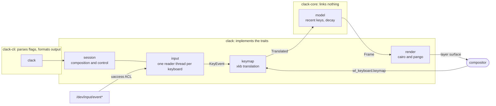

# Design

Why Clack is built the way it is. See [`README.md`](README.md) for what it does and [`engineering/README.md`](engineering/README.md) for how it is written.

## Why screenkey cannot work on Wayland

Screenkey talks to `libX11` and reads the whole key event stream. That works because the X server is a global input broker: any client can ask it for every event. Wayland has no such broker. The compositor delivers key events only to the focused surface, and no protocol exists to ask for the rest. Under XWayland screenkey still sees X11 clients, which is why it looks half broken rather than dead.

Positioning fails too: screenkey places its window at absolute coordinates, and Wayland has no client-side window positioning.

## Getting the keys

Four candidates. Only one works.

| Source | Verdict |
|---|---|
| `wl_keyboard` key events | No. The compositor must not send `key` without the client's surface holding focus. |
| `xdg-desktop-portal` InputCapture | No. Built for InputLeap-style edge handoff: declare Zones, place PointerBarriers, receive events only after one is crossed. Deliberately not a keylogger. |
| `xdg-desktop-portal` RemoteDesktop with libei | No. Emulation-first, and the same capture semantics apply. The EIS implementation decides which devices exist and when they may send. |
| evdev on `/dev/input/event*` | Yes. Below the compositor. Works on KWin, Mutter, wlroots, and a bare TTY. Needs privileges. |

So Clack reads the kernel devices, and the README says so plainly.

**Privileges.** A udev `uaccess` rule is the default. On NixOS the flake's module puts it in `services.udev.packages`; everywhere else `clack --install-rule` writes it through polkit, which prompts once and leaves nothing elevated. Installing the package without either step does nothing, because udev only reads rules a system has been told about.

The rule itself: logind grants an ACL to the active seat's user, revoked at logout. The file must sort after `60-input-id.rules`, which sets `ID_INPUT_KEYBOARD`, and before `73-seat-late.rules`, which applies the ACL. Hence `65-`. Rejected: `input` group membership, which is permanent and seat-independent; setuid, which is hard to audit. A pkexec helper passing read-only fds over `SCM_RIGHTS` remains the fallback for users who will not install a rule.

**Not libinput.** wshowkeys and Show Me The Key both use it. Clack wants raw key codes, and libinput's value is pointer acceleration, gesture recognition, and device grouping, all of which would be discarded. It would also force the `open_restricted` privilege callback. The `evdev` crate reads the same devices with no C dependency. The cost is hotplug, recoverable with an inotify watch on `/dev/input`.

## Turning codes into symbols

evdev gives raw key codes; an XKB keymap turns them into `Shift+A` or `é`. XKB keycodes sit eight places above kernel codes.

`wl_keyboard.keymap` is sent to any client that calls `wl_seat.get_keyboard`, with no surface and no focus required; only `key` needs focus. Clack pulls the compositor's live keymap that way, so the layouts configured in Plasma's own settings are the ones it displays. Show Me The Key compiles its own XKB config and misses desktop-level remaps.

Verified on KWin: 36826 bytes, seat `seat0`, no surface, no focus.

Open: the active layout group index arrives in `wl_keyboard.modifiers`, which a compositor may send without focus but need not.

## Drawing

`wlr-layer-shell`, overlay layer. KWin implements it at version 6.6, alongside Mutter, sway, Hyprland, COSMIC, and Weston.

This is the thing prior art gets wrong. Show Me The Key draws into an ordinary GTK toplevel and tells users to write compositor window rules; on Plasma it ends up underneath other windows, because a Wayland client cannot raise or pin itself. Layer shell gives edge anchoring, guaranteed z-order, and, with an empty input region and `keyboard_interactivity = none`, a surface that never takes focus or clicks.

Two behaviours learned the hard way, both from KWin:

- A layer surface becomes mappable only after an empty commit answered by a configure. Waiting for a configure on every resize hangs, because a mapped surface at an unchanged size gives the compositor nothing to say.
- Never unmap. An unmapped layer surface returns without its anchor and assigned to the current workspace only. Clack stays mapped and paints a transparent buffer when idle.

Rendering happens at the output's integer buffer scale; otherwise the compositor upscales and the text blurs.

No fallback for compositors without layer shell. Clack errors out with a clear message rather than degrading into the failure mode above.

## Shape

Three crates, so that "the CLI is one consumer among several" is enforced by the dependency graph rather than by intent.

`clack-core` holds the model and the traits it consumes: `KeySource`, `Translator`, `Surface`, `Clock`. It links nothing and needs no devices, which is the test for whether the layering is real.

`clack` implements those traits and composes them. `Session` owns a running Clack and is generic over the surface, so the overlay, a terminal, a tray applet, and a browser are the same thing to it. `Handle` clones cheaply and controls a session from another thread: pause, resume, stop. A paused session keeps reading keys and shows nothing, so nothing typed during a pause is retained. `Report` gathers what `--check` needs as data, leaving the wording to whoever displays it.

`clack-cli` parses flags and formats output. It holds no logic that a GUI would need to reimplement.

`settings` owns the file format, at `$XDG_CONFIG_HOME/clack/config.toml`. It is deliberately a separate type from `Config`: the file is a wire format that can be half-written, out of date, or wrong, and `to_config` is where it becomes something a session can run. The command line and the tray both go through it, so they cannot drift apart. Unknown keys are rejected rather than ignored, and a file that exists but cannot be parsed is an error rather than a silent reset to defaults.

Modules in `clack`: `input` enumerates and reads devices, reporting per-device access so a permission failure can be explained. `keymap` fetches and compiles the keymap and resolves key events. `render` owns the layer surface and paints with cairo and pango. `text` writes plain lines to any writer, and doubles as the smallest example of implementing `Surface`.

## The tray app

`apps/tray` is a Tauri shell around the library, kept out of the Cargo workspace so the CLI's build and CI stay free of a browser engine. Its Rust side runs a `Session` on a background thread and holds a `Handle`; the web view is a form.

Two host quirks it works around, neither a choice:

- GTK3 has no `xdg-decoration` support, so on Wayland it always draws its own titlebar, which looks foreign on KDE. Running under XWayland gets the desktop's own decorations instead.
- On a non-NixOS host, the Nix build of webkitgtk cannot reach the system GPU drivers and the web view stays blank. `scripts/tray.sh` routes it through nixGL.

## Testing

Two hazards shape all of this: a test that types into the developer's session, and a test that draws on their screen. Neither is prevented by being careful, so both are prevented structurally.

- Keys are always fed through a pipe of `input_event` records, never a uinput device. A uinput device is a real kernel keyboard, so the compositor delivers its events to whatever window has focus. That was tried, and it typed into the developer's windows.
- Anything that opens a surface is gated behind `CLACK_NESTED_COMPOSITOR`, which only the scripts set. A plain `cargo test` skips those tests with a message rather than flashing a surface on screen. The scripts also refuse to run if `WAYLAND_DISPLAY` matches the host's.
- Screenshots are taken inside the nested compositor. Capturing the real screen once captured a private conversation.

The layers:

- Domain: pure, no devices, no compositor.
- Translation: a committed xkb keymap fixture, so chords, shift levels, unmapped codes, and lone modifiers are covered without a compositor.
- Pipeline: `Session::from_parts` with a pipe source, the fixture keymap, and a recording surface.
- End to end: `scripts/e2e.sh` runs the built binary inside a headless sway, types through a pipe, and checks from screenshots that the overlay appeared where it is anchored and nowhere else.

## Next

1. screenkey's display semantics: composed, translated, raw, and keysyms modes; backspace handling; repeat compression; glyph styles for modifiers.
2. Theming and a config file.
3. Fractional scale, via `wp_fractional_scale_v1` and `wp_viewporter`. Integer scale is handled; a 1.75 output still resamples.
4. Verify the overlay stays above a fullscreen window on KWin.
5. Hotplug.
6. Multi-seat and multi-keyboard behaviour.

## Prior art

- [screenkey](https://www.thregr.org/wavexx/software/screenkey/): the behaviour to match. X11 only.
- [wshowkeys](https://sr.ht/~sircmpwn/wshowkeys/): right rendering approach, setuid root, unmaintained.
- [Show Me The Key](https://github.com/AlynxZhou/showmethekey): pkexec helper plus a GTK4 toplevel, so the overlay sits under other windows on Plasma.
- [koverlay](https://github.com/erik96/koverlay): not a keystroke tool, but a click-through layer-shell overlay targeting KWin.

## References

- [Wayland Book: keyboard input](https://wayland-book.com/seat/keyboard.html)
- [wlr-layer-shell-unstable-v1](https://wayland.app/protocols/wlr-layer-shell-unstable-v1)
- [XDG InputCapture portal](https://flatpak.github.io/xdg-desktop-portal/docs/doc-org.freedesktop.portal.InputCapture.html)
- [who-t: libei and the portals](http://who-t.blogspot.com/2022/12/libei-opening-portal-doors.html)
