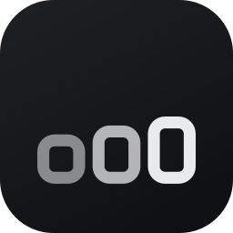
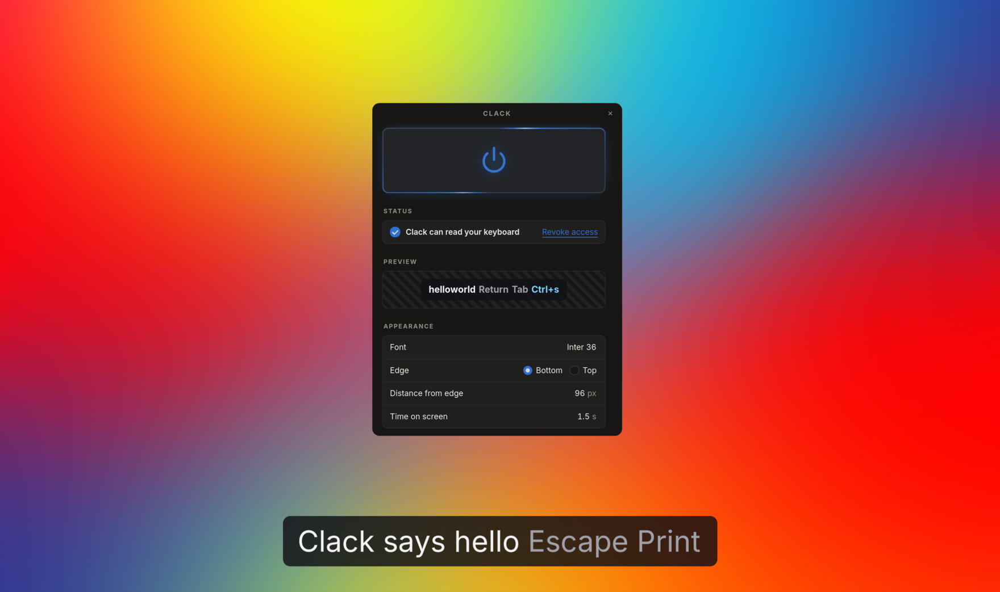

<div align="center">



# Clack

Shows the keys you press, on screen, for screencasts, demos and teaching. For Wayland
desktops.

[](https://github.com/fnune/clack/actions/workflows/ci.yml)
[](https://github.com/fnune/clack/releases/latest)



</div>

There is a desktop app with a tray icon and a single switch, and a command line program. Both do
the same thing and share the same settings.

## What Clack can see

Clack reads every keystroke on the machine, including keystrokes typed into other applications,
including passwords. There is no way to show your keystrokes without that ability.

What it does with it:

- Nothing is written to disk. No history, no cache.
- No network code exists in this project.
- No keystroke enters a log, at any level, in any build.
- Only devices reporting as keyboards are opened, read-only, never grabbed.

The overlay is the indicator that Clack is running. Stop it before you type a password.

## Install

### The desktop app

Download `Clack-x86_64.AppImage` from [the latest
release](https://github.com/fnune/clack/releases/latest), make it executable, and run it:

```sh
chmod +x Clack-x86_64.AppImage
./Clack-x86_64.AppImage
```

It puts an icon in your tray. Click the switch to start showing your keys.

To have it in your application menu, take `clack.desktop` from the same release and point it at
where you kept the AppImage:

```sh
install -Dm644 clack.desktop ~/.local/share/applications/clack.desktop
sed -i "s|^Exec=.*|Exec=$PWD/Clack-x86_64.AppImage|" ~/.local/share/applications/clack.desktop
```

The entry names its icon `clack`, which your theme has no copy of until you give it one:

```sh
./Clack-x86_64.AppImage --appimage-extract usr/share/icons >/dev/null
install -Dm644 squashfs-root/usr/share/icons/hicolor/512x512/apps/clack-desktop.png \
  ~/.local/share/icons/hicolor/512x512/apps/clack.png
```

### The command line

Download `clack-linux-amd64` from the same release and put it on your `PATH`:

```sh
install -Dm755 clack-linux-amd64 ~/.local/bin/clack
clack --check
```

### With Nix

On NixOS, add the flake as an input and enable the module:

```nix
{
  inputs.clack.url = "github:fnune/clack";

  # in your configuration
  imports = [ inputs.clack.nixosModules.default ];
  programs.clack.enable = true;
}
```

Elsewhere, `nix run github:fnune/clack`. Installing the package into a profile is not enough on
its own, because udev only reads rules a system has been told about; the module handles that, and
so does `--grant-access` below.

With Home Manager, the same options write the settings file:

```nix
{
  imports = [ inputs.clack.homeManagerModules.default ];

  programs.clack = {
    enable = true;
    desktop.enable = true;
    settings = {
      overlay = {
        font = "Iosevka Bold 30";
        anchor = "top";
        timeout_seconds = 1.5;
        symbols = true;
      };
      desktop.start_hidden = true;
    };
  };
}
```

Anything left unset is left out of the file, so Clack's own default applies. The file belongs to
the Nix store and cannot be written to, so the desktop app says so and treats what you change in
its window as lasting until it quits. Reading keyboards is still the system's to allow: use the
NixOS module above, or `--grant-access` below.

`desktop.enable` adds the desktop app, taken from the AppImage published with the release and
given an application menu entry. Both programs read the one settings file, so there is nothing to
configure twice.

The two are versioned apart. The command line is built from the commit your input points at; the
desktop app is a published artefact, and what you get is the release that commit names, which is
the last one made rather than the source beside it. Pinning the input to today's `main` still
installs the last released app, so the two can differ until a release catches up.

## Letting Clack read your keyboard

Clack reads the kernel's input devices, which on most systems needs permission your user does not
have. Run `clack --check` first: if it reports readable keyboards, there is nothing to do.
Otherwise grant it once:

```sh
clack --grant-access
```

You are asked for your password once, nothing stays elevated, and later launches ask for nothing.
`clack --revoke-access` takes it back, straight away rather than at your next login, and leaves
nothing of Clack's outside your home directory. The desktop app has a button for both.

## Use

```sh
clack                                       # show the overlay, Ctrl+C to stop
clack --check                               # will Clack work here?
clack --anchor top --margin 140 --timeout 3 # where it sits, and for how long
clack --font "JetBrains Mono Bold 28"       # any font Pango can name
clack --symbols                             # space and enter get glyphs, not names
clack --print                               # keystrokes on stdout, to pipe anywhere
clack --reset                               # settings back to defaults, keeping a copy
```

`--help` lists the rest. Your layout comes from your desktop, so what you configured there is
what Clack shows.

## Settings

One file, at `$XDG_CONFIG_HOME/clack/config.toml`, drives both programs. `clack --config-path`
prints where that is. Flags override it for a single run; the desktop app writes to it as you
change things.

```toml
[overlay]
font = "Sans Bold 24"
margin = 96
anchor = "bottom"
timeout_seconds = 1.5
symbols = false

[overlay.symbol_overrides]
Tab = "→"

[desktop]
start_hidden = false
start_overlay = false
decorations = false
```

Anything you leave out keeps its default. A key Clack does not recognise is an error rather than a
silent no-op, so a typo tells you instead of quietly doing nothing.

## How it works

Wayland gives no client the ability to watch another client's input, so screenkey's approach has no
equivalent here. Clack reads `/dev/input/event*` directly, takes the keyboard layout from the
compositor, and draws on a `wlr-layer-shell` surface, which is what puts the overlay above other
windows rather than behind them.

Developed on KDE Plasma. Works on any compositor implementing layer shell, which is most of them
apart from GNOME's Mutter.

[`DECISIONS.md`](DECISIONS.md) has the alternatives, why each one fails, and the compositor
behaviour behind the drawing code.

## As a library

Both programs are consumers of the `clack` crate. The overlay is one implementation of `Surface`,
and anything else that can show a `Frame` will do:

```rust
use clack::{Config, Frame, LiveSession, Surface};

struct Caption(String);

impl Surface for Caption {
    type Error = std::convert::Infallible;

    fn present(&mut self, frame: &Frame) -> Result<(), Self::Error> {
        self.0 = frame.runs.iter().map(|run| run.text.as_str()).collect();
        Ok(())
    }
}

let mut session = LiveSession::with_surface(Caption(String::new()), &Config::default())?;
session.run()?;
```

`session.handle()` gives a `Handle` that pauses, resumes and stops the session from another thread,
and is the only thing that crosses one. Reading, naming and drawing happen on the thread that
called `run`.

## Development

Everything comes from a [Nix](https://nixos.org/download/) flake:

```sh
nix develop
just            # lists every task
just check      # what CI runs
just desktop    # the desktop app, in development
just e2e        # the built binary, a real compositor, checked from pixels
```

Commits follow [conventional commits](https://www.conventionalcommits.org), which
[`CHANGELOG.md`](CHANGELOG.md) is generated from.
[`engineering/README.md`](engineering/README.md) has the principles and conventions.

MIT licensed.
